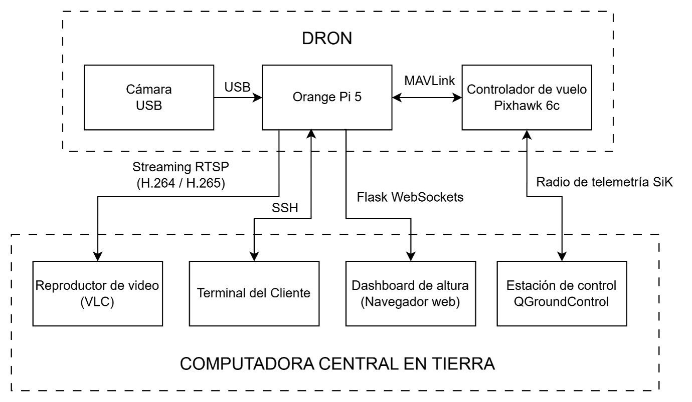

# Embedded AI Drone-Based System for Grapevine Health Monitoring

This project presents an artificial vision system for real-time grapevine health monitoring using an autonomous aerial vehicle.
The system uses a cascade pipeline consisting of a YOLOv8-nano segmentation model to isolate 
grapevine leaves from complex backgrounds, followed by a customized ResNet-50 classifier
for binary health assessment (healthy or unhealthy).

This program is meant to run on an edge device with a camera module, Wi-Fi capabilites and an NPU.
During development, the program was tested on an Orange Pi 5 with a RK3588 processor running [Armbian](https://imager.armbian.com/#downloads).
This Linux distro was used to allow wi-fi communication, which is restricted in the distro from Orange Pi.
## Installation
This program runs exclusively on Python <= 3.9 required by `dronekit`, the library used for MAVLINK communication
between the edge device board and the drone flight controller.
Make sure the right Python version is installed.
Python dependencies are listed in `requirements.txt`. 

```bash

python3 --version
#should print 3.9.X or earlier
git clone https://github.com/alozano510/precision-viticulture
cd precision-viticulture
pip install -r requirements.txt
```
To run the program on an NPU, ```rknn-toolkit-lite2``` must be installed
using the wheel compatible with the platform. See [RKNN Toolkit2](https://github.com/airockchip/rknn-toolkit2/tree/master/rknn-toolkit-lite2).
This is the one used for the project:
```bash

wget https://github.com/airockchip/rknn-toolkit2/blob/master/rknn-toolkit-lite2/packages/rknn_toolkit_lite2-2.3.2-cp39-cp39-manylinux_2_17_aarch64.manylinux2014_aarch64.whl
pip install rknn_toolkit_lite2-2.3.2-cp39-cp39-manylinux_2_17_aarch64.manylinux2014_aarch64.whl 
```

To run the ```rtsp_stream_server.py``` to stream the video to a ground computer, the following extensions must be installed.

```bash 

sudo apt update
sudo apt install -y \
    libcairo2-dev \
    libgirepository2.0-dev \
    libglib2.0-dev \
    python3-dev \
    gcc
```

## System Communication Diagram



## Program Parameters

### Config File
```config.json``` contains parameters that may be changed to adapt the program to the running environment.

| Parameter              | Default   | Description                                                             |
|------------------------|-----------|-------------------------------------------------------------------------|
| `drone`                | false     | Enable connection to a physical drone                                   |
| `simulator`            | false     | Run with a  SITL simulator instead of a real drone                      |
| `orangepi`             | false     | Enable to run on Orange Pi                                              |
| `sitl_simulation_port` | tcp:127.0.0.1:5763 | Communication port for the SITL simulation                              |
| `graphics`             | true      | Enable graphical output/visualization of the vision system on a monitor |
| `dashboard`            | false     | Enable the Flask/SocketIO live telemetry dashboard                      |

#### drone_config

| Parameter                | Default  | Description                                                 |
|--------------------------|----------|-------------------------------------------------------------|
| `port`                   | /dev/ttyS4 | Serial port used for communication with the drone (MAVLink) |
| `communication_baudrate` | 57600    | Baud rate for the serial communication                      |

#### camera

| Parameter | Default | Description |
|-----------|-----|---|
| `fps`     | 24  | Camera capture frame rate |
| `width`   | 640 | Camera frame width|
| `height`  | 480 | Camera frame height |

#### vine_health_classifier

| Parameter | Default | Description |
|-----------|------|---|
| `fps`     |10    | Inference rate for the vine health classification pipeline |

#### rtsp_stream_server

| Parameter | Default | Description |
|-----------|----|---|
| `host`    | 0.0.0.0 | Bind address for the RTSP server (all interfaces) |
| `port`    | 8554 | RTSP server port |
| `path`    | /stream | RTSP stream path (e.g. `rtsp://host:8554/stream`) |
| `fps`     | 20 | Output stream frame rate |
| `width`   | 640 | Output stream width |
| `height`  | 480 | Output stream height |

## Running the program

### Input Arguments

When running the main program, the paths for both the ResNet-50 model [cnn_model_path] and the YOLOv8 model [yolo_model_path]
must be specified.

```
usage: main.py [cnn_model_path] [yolo_model_path]
```
### Optional Arguments

| Argument                                       | Type  | Default | Description                                                                                |
|------------------------------------------------|-------|---------|--------------------------------------------------------------------------------------------|
| -c, --camera CAMERA                            | int   | 0       | Camera used for the vision system                                                          |
| -lc, --leaf_detection_conf_threshold THRESHOLD | float | 0.25    | Confidence threshold for leaf detection with YOLO model                                    |
| -iou, --leaf_detection_iou_threshold THRESHOLD | float | 0.45    | Overlap threshold for detected leaves                                                      |
| -hu, --hybid_unhealthy_threshold THRESHOLD     | float | 0.4     | Threshold of percentage of unhealthy leaves detected to consider the whole plant unhealthy |

After running `main.py` the `DronShell` will initialize. Here you can execute any function using the CLI.

```bash

main.py [cnn_model_path] [yolo_model_path]

Welcome to the drone shell. Type help to list commands.
(drone) 
```

## Functions overview

### Vine Analysis
Starts a preloaded mission on the UAV with a velocity of 2 m/s and runs the vision model.
```bash

(drone) vine_analysis
```

### Manual Vision
Runs the vision system without initializing a drone mission. A vision model must be specified (classification/detection/hybrid)

**Classification:** Runs the ResNet-50 classifier for binary health assessment (healthy or unhealthy)

**Detection:** Runs the YOLOv8-nano segmentation model to detect grapevine leaves.

**Hybrid**: Runs a cascade pipeline consisting of a YOLOv8-nano segmentation model to isolate grapevine leaves from complex backgrounds, followed by a customized ResNet-50 classifier for binary health assessment

```bash

(drone) manual_vision <vision model>
```

### Altitude control
Initializes flight and keeps the drone hovering at a given <ref> altitude in meters. Latitude and longitude are controlled to stay as the starting ones.
```bash

(drone) altitude_control <goal altitude in meters>

# How to change goal altitude
(drone) ref <goal altitude in meters>

# How to land
(drone) stop # The program reduces the UAV speed and starts a landing routine.
```

### How to stop any program
```bash

(drone) stop
```

## Outputs

After stopping the program, the annotated video stream of the vision system is saved as `.mp4` along with the performance of the vision models as `.csv` under `/runs`

## Running on DEV mode vs on Orange Pi

### DEV mode

For development, the program can be run on a PC running Windows.
To visualize the vision system in real time on your screen during testing, set the `graphics` parameter in `config.json` to `True`.

To test UAV control related functions, initialize the SITL simulator Mission Planner from ArduPilot and set the `simulator` parameter to True. 
For more information on how to install and run Mission Planner, visit https://ardupilot.org/planner/docs/mission-planner-installation.html

### Orange Pi

To run in an Orange Pi, set the `orangepi` parameter in `config.json` to True.

When mounted and connected to the UAV, set the `drone` parameter in `config.json` to True.

## Video Stream

The drone video feed, including the computer vision system's annotations, is streamed in real time through an RTSP server. To access the stream, use a media player such as VLC Media Player for Windows. In the application, select **Media → Open Network Stream** and enter the IP address of the Orange Pi 5 followed by port `8554` (or whatever port is specified in `config.json`). 

```
rtsp://<ip_orangepi>:8554/stream 
```

## Training Your Own Models

**Pretrained models and weights are not included in this repository.** To
run the system, you must train the YOLO leaf detector and CNN health
classifier yourself using the scripts below, which reproduce the exact
architectures used during testing. Dataset links are provided at the end of
this section. Training on these datasets was done using default hyperparameters.

The scripts live in `utils/training/` and `utils/conversion/`.

### Pipeline overview

1. **Prepare data** — `utils/conversion/mask_to_coordinates.py` converts
   segmentation masks into YOLO-format polygon labels.
2. **Train** — `utils/training/yolo_training.py` and
   `utils/training/cnn_training.py` train the detector and classifier
   independently.
3. **Convert to ONNX** — `utils/conversion/cnn_torch_to_onnx.py` exports the
   PyTorch classifier to ONNX (YOLO exports to ONNX automatically as the last
   step of `yolo_training.py`).
4. **Convert to RKNN** — `utils/conversion/cnn_onnx_to_rknn.py` and
   `utils/conversion/yolo_onnx_to_rknn.py` convert each ONNX model into the
   `.rknn` format the Orange Pi 5 / RK3588 NPU runs at inference time.

You must complete all four steps before `VineHealthClassifier` in `main.py`

### Datasets

The datasets used for training are not of my authority. These are available through the following links:

- Classifier dataset (used for custom CNN): https://www.kaggle.com/datasets/bmshahriaalam/grape-leaf-disease/data
- Detector dataset (YOLOv9 model): https://www.kaggle.com/datasets/janvahrenhold26/vine-leaf-instance-segmentation